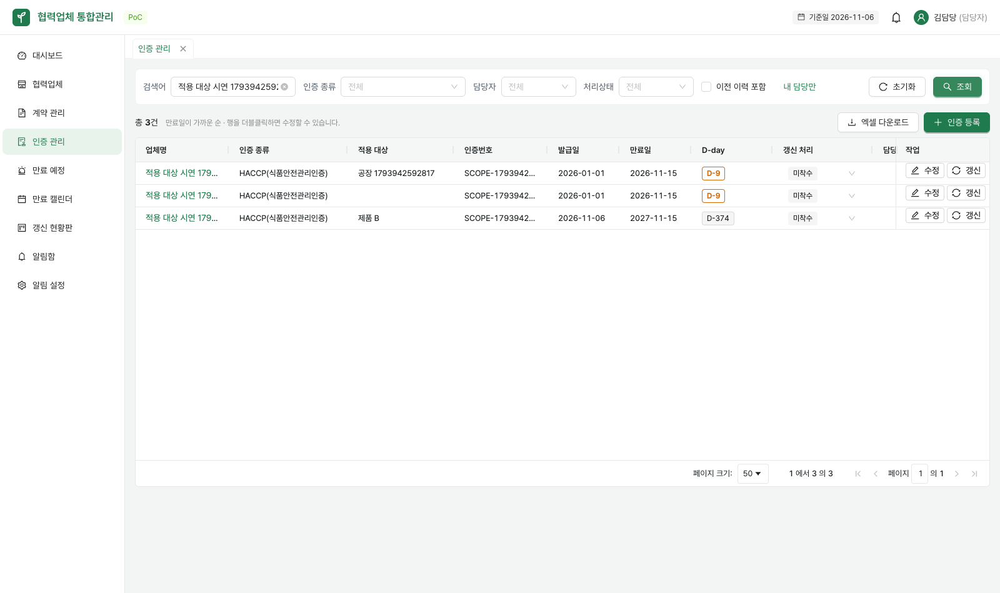
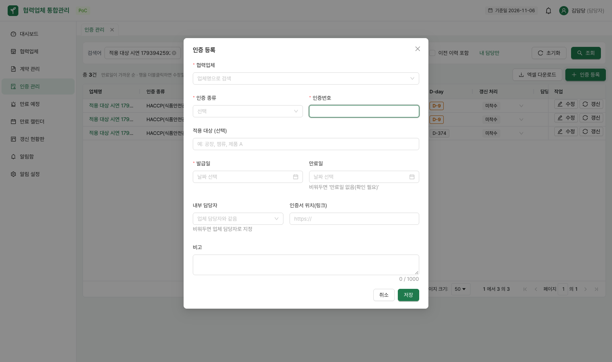
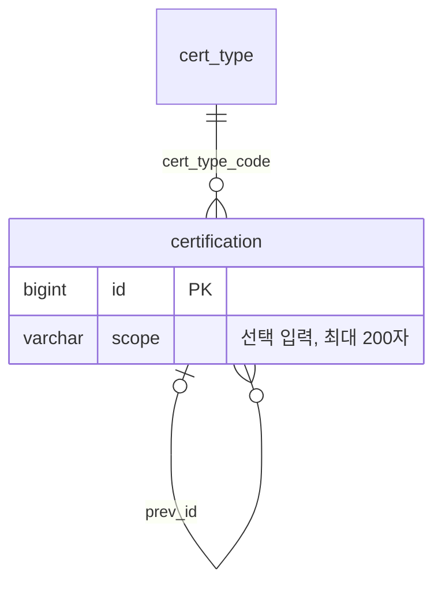

# 인증 적용 대상

같은 업체·인증 종류라도 공장·품목군·제품별로 구분할 수 있도록 인증마다 **적용 대상**을 선택 입력한다. 예시는 `공장`, `잼류`, `제품 A`이며 실제 대상은 담당자가 직접 입력한다.





## 입력·검색·갱신

- ADMIN·MANAGER는 등록·수정·갱신에서 입력하고 VIEWER는 조회만 한다.
- 최대 200자이며 앞뒤 공백은 제거한다. 미입력·null·빈 문자열·공백은 null로 저장한다. 기존 데이터의 메모나 파일명에서 값을 추정하지 않는다.
- 인증 관리와 업체 상세의 인증 목록에서 독립된 적용 대상 열로 확인한다. 인증 엑셀에도 같은 열을 제공한다.
- 기존 키워드 검색은 업체명·인증번호·적용 대상의 부분 일치 검색이다. 종류·담당자·처리상태·업체·이전 이력·페이지 조건과 함께 적용된다.
- 갱신 창은 이전 적용 대상을 기본값으로 가져온다. 수정하거나 비울 수 있고, 저장된 새 인증은 이전 인증의 값과 갱신 연결을 변경하지 않는다.
- 만료 목록·캘린더·갱신 현황판·대시보드·파일 연결 이름과 새 알림에는 `인증 종류 · 적용 대상`을 표시한다. 대상이 없으면 기존 인증 종류만 표시한다. 이미 생성된 알림은 생성 당시 문구를 유지한다.

## API

인증 등록 `POST /api/certifications`, 수정 `PUT /api/certifications/{id}`, 갱신 `POST /api/certifications/{id}/renew` 요청에 선택 필드 `scope`를 추가한다.

```json
{
  "supplierId": 1,
  "certTypeCode": "HACCP",
  "certificateNumber": "DEMO-001",
  "scope": "제품 A",
  "issuedDate": "2026-01-01",
  "expiryDate": "2027-01-01"
}
```

목록·상세·저장 응답은 `scope: string | null`을 포함한다. `certTypeName`은 인증 종류의 원래 이름을 유지한다. 200자를 초과하면 400 응답의 `errors[].field`는 `scope`다. 길이 검증은 요청 문자열 기준이며 이후 앞뒤 공백을 제거한다.

`GET /api/certifications?keyword=제품`과 `/api/certifications/excel`의 같은 검색 조건으로 대상 검색이 가능하다. 갱신 API에는 새 인증에 저장할 `scope`를 보내며 생략·null은 미지정이다. 기본값 복사는 갱신 화면에서 수행한다.

만료 API의 `name`은 표시용 문자열이므로 적용 대상을 포함한다. 기존 식별자(`targetId`, `targetType`)나 인증번호, 인증 종류 코드는 변경하지 않는다.

## DB와 적용 순서

V11 `certification_scope`는 `certification.scope varchar(200) NULL` 컬럼을 추가한다. 기존 행은 null이고 별도의 데이터 보정이나 실제 자료 등록은 없다. 업체명·인증 종류·적용 대상을 최대 길이로 입력해도 알림 생성이 실패하지 않도록 기존 알림 제목과 본문 컬럼의 길이도 늘린다.

| 필드 | 형식 | 의미 |
|---|---|---|
| `certification.scope` | varchar(200), NULL 허용 | 담당자가 입력한 인증 적용 대상 |
| `notification.title` | varchar(500), NOT NULL | 대상이 포함된 알림 제목 (기존 200자에서 확대) |
| `notification.message` | varchar(1000), NOT NULL | 대상이 포함된 알림 본문 (기존 500자에서 확대) |



V9는 자료실 폴더 PR #35, V10은 인증 종류 PR #38이 사용한다. **V9 → V10 → V11이 포함된 통합 브랜치 순서로 배포**한다. V11만 먼저 운영 DB에 적용하면 앞선 마이그레이션이 뒤늦게 적용되지 않을 수 있다.
