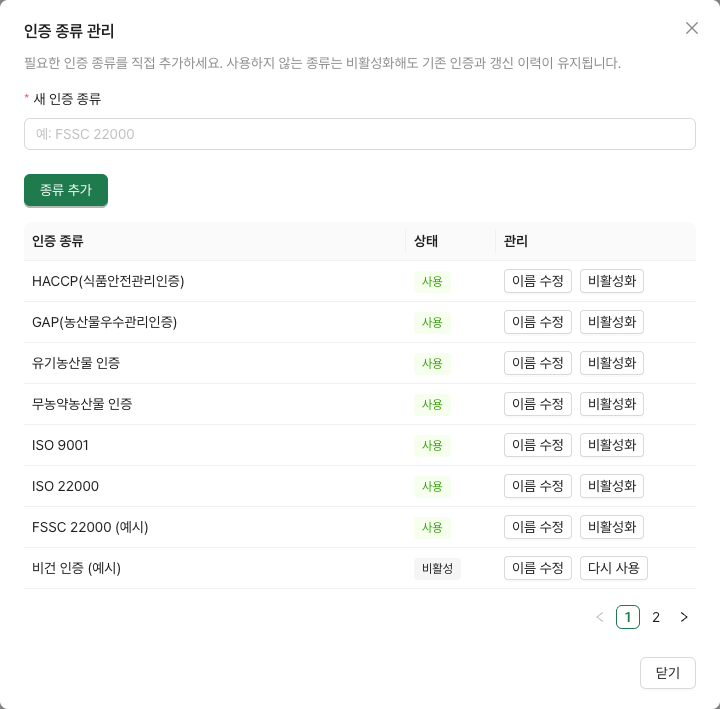
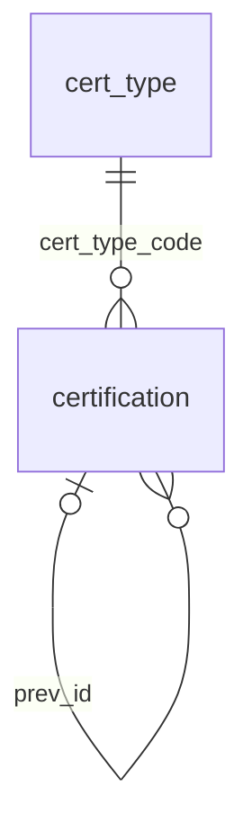

# 인증 종류 관리

인증 관리 화면의 **인증 종류 관리** 버튼은 관리자(ADMIN)에게만 보인다. 관리자는 이름으로 종류를 추가하거나 기존 이름을 수정하고, 사용하지 않는 종류를 비활성화·재활성화할 수 있다. 담당자(MANAGER)는 등록된 종류를 인증에 사용하고 조회자(VIEWER)는 조회만 한다.



## 기존 기록과 선택 규칙

- 종류의 코드는 서버가 생성하는 불변 식별자다. 이름을 바꾸면 기존 인증도 새 이름으로 표시되며 인증번호·갱신 연결·문서 링크는 유지된다.
- 검색 필터에는 비활성 종류도 `(비활성)` 표시와 함께 나온다.
- 새 인증과 갱신에는 사용 중인 종류만 선택할 수 있다. 비활성 종류로 갱신하려면 관리자가 재활성화하거나 등록자가 다른 사용 중인 종류를 선택한다.
- 기존 인증을 수정하면서 원래 종류를 유지하는 경우에는 비활성이어도 저장할 수 있다. 다른 비활성 종류로 변경할 수는 없다.
- 인증 종류의 비활성화는 해당 종류를 가진 인증 건의 활성/갱신 상태와 별개다. 인증 만료 점검이나 이전 이력이 사라지지 않는다.
- 이름은 100자 이내다. 앞뒤 공백을 제거하고 연속 공백을 한 칸으로 정리한다. 공백 전체와 대소문자를 제외한 이름이 같으면 비활성 종류를 포함해 중복으로 처리한다.
- 종류를 수정하면 현재 화면의 관련 목록을 다시 조회한다. 다른 사용자가 수정한 종류도 선택창을 다시 열거나 창에 포커스를 주면 갱신한다.

## API

| 메서드·경로 | 권한 | 요청·응답 |
|---|---|---|
| GET `/api/cert-types` | 로그인 사용자 | `{code, name, active}[]` — 검색·기존 기록을 위해 비활성 포함 |
| POST `/api/admin/cert-types` | ADMIN | `{name}` → 생성된 `{code, name, active: true}`, 201 |
| PUT `/api/admin/cert-types/{code}` | ADMIN | `{name}` → 이름이 수정된 `{code, name, active}`, 200 |
| PATCH `/api/admin/cert-types/{code}/active` | ADMIN | `{active}` → 사용 여부가 수정된 `{code, name, active}`, 200 |

빈 이름·길이 초과·중복은 400이며 `errors[].field = name`으로 안내한다. 없는 코드는 404, 비관리자의 변경 요청은 403이다. 사용 여부 변경에서 `active`를 누락하면 400이다. 이름 변경과 사용 여부 변경을 분리해 다른 관리자의 변경을 서로 덮어쓰지 않는다. 삭제 API는 제공하지 않는다.

인증 POST/PUT/갱신 API는 `certTypeCode`로 종류를 선택한다. 선택 필드 `scope`는 [인증 적용 대상](cert-scope.md)을 따른다. 허용되지 않은 비활성 종류 선택은 400, `errors[].field = certTypeCode`다. 실패한 갱신은 기존 인증의 상태 변경까지 롤백한다.

## DB

V10 `cert_type_management`가 기존 `cert_type`에 다음 필드를 추가한다. 기존 종류는 모두 `active = true`로 시작하며 PK와 인증 FK는 그대로 유지한다.

| 필드 | 타입 | 용도 |
|---|---|---|
| `code` | varchar(30), PK | 기존 코드 보존, 신규 코드는 서버 생성 |
| `name` | varchar(100) | 표시 이름 |
| `sort_order` | int | 표시 순서, 새 종류는 마지막에 추가 |
| `active` | boolean, NOT NULL | 새 인증에서 선택 가능한지 여부 |
| `name_key` | varchar(300), NOT NULL, UNIQUE | 공백 제거·소문자 이름, 동시 중복 저장 차단 |



정규화 중 길이가 늘어나는 유니코드 이름을 위해 비교 키에 여유를 둔다. 인증 저장 중에는 종류에 읽기 잠금을, 종류 수정에는 쓰기 잠금을 사용해 비활성화와 인증 저장의 순서를 보장한다.

V9는 진행 중인 자료실 PR #35가 사용하므로 V10을 선택했다. 배포 전 관련 PR의 마이그레이션 순서를 함께 확인한다. V10이 먼저 적용된 DB에는 이후 V9가 기본 Flyway 설정에서 적용되지 않으므로, V9를 포함한 통합 브랜치로 배포하거나 아직 배포하지 않은 후속 마이그레이션의 번호를 정리해야 한다. 적용 완료된 마이그레이션 파일은 수정하지 않는다.

## 검증

```sh
cd backend
./gradlew test --tests '*CertTypeApiTest' --tests '*ContractApiTest'
# 통합 테스트에는 Docker와 Java 21이 필요하다.
```

`CertTypeApiTest`는 실제 PostgreSQL에서 이름 검증·동시 중복·권한·비활성 선택·갱신 실패 롤백·기존 이력과 링크 보존을 확인한다. 프론트엔드는 의존성 요구 조건에 맞는 Node 24에서 `npm run build`, `npm run lint`를 실행한다.
