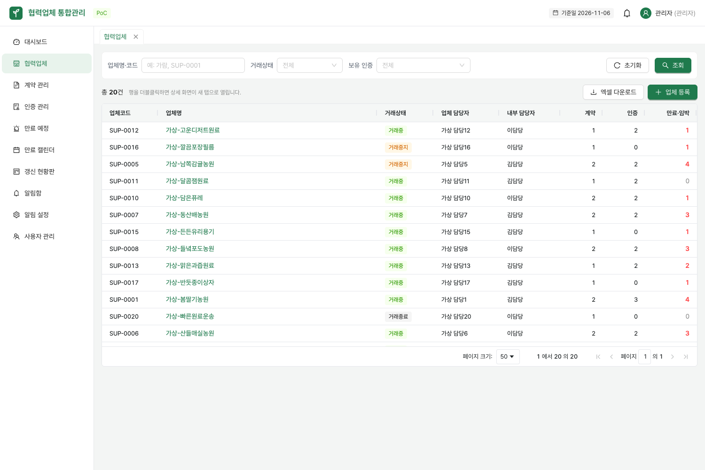
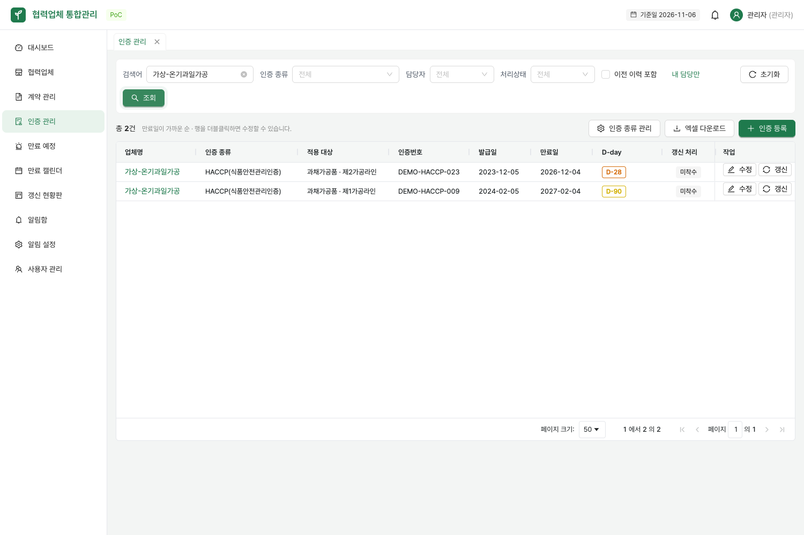

# 가상 시연 데이터

#14의 샘플은 식품 원료·포장재·물류 업무를 보여 주기 위한 **완전한 가상 데이터**다. 한국농산에서 받은 파일, 실제 업체명·거래·인증번호·연락처를 복사하지 않는다. 실제 자료는 회사 담당자가 기능을 통해 직접 등록한다.

## 구성

| 구분 | 예시와 확인할 기능 |
|---|---|
| 사용자 4명 | admin·manager1·manager2·viewer, 기존 시연 계정과 권한 유지 |
| 업체 20곳 | 원료 농가 8곳·식품 가공 6곳·포장재 3곳·물류 3곳. 업종은 기존 비고에 표시 |
| 계약 30건 | 업체에 맞는 원료 공급·포장재 공급·배송/보관/운송 위탁 계약 |
| 인증 30건 | 농가의 GAP, 식품 가공의 HACCP·ISO 22000·FSSC 22000 예시 |

- 업체명은 `가상-`, 인증번호와 입력된 계약번호는 `DEMO-`로 시작한다. 사업자등록번호는 비워 둔다.
- 연락처는 가상 담당자와 예시 전화번호·`example.com` 메일이다. 계약의 `docs.example.com` 주소는 실제 문서가 없는 링크 예시이며 첨부파일은 만들지 않는다.
- 포장재·물류 업체에는 농가·식품 가공 인증을 임의로 붙이지 않는다. 이 샘플 배정은 해당 업종의 인증 의무나 실제 보유 여부를 뜻하지 않는다.
- 같은 식품 가공 업체에 서로 다른 HACCP 적용 대상을 넣어 목록·검색·갱신·만료 안내에서 구분한다. 적용 대상이 없는 인증도 1건 포함한다.
- 계약번호가 없는 계약 10건, 자동연장 계약 1건, 갱신 진행 중 계약 2건·인증 1건을 포함한다.
- 거래중 17곳·거래중지 2곳·거래종료 1곳이며, 날짜는 최초 생성일 기준 상대값이다. 만료·당일·7일·30일·90일 경계, 계약 종료일 없음과 인증 만료일 없음도 유지한다.

FSSC 22000은 새 dev 샘플에만 추가한다. 기존 인증 종류를 삭제하거나 과거 Flyway 파일을 바꾸지 않는다. 사용한 종류는 시연용 선택이며 **한국농산 담당자가 확정한 관리 목록은 아니다.**





## 생성 조건과 기존 자료 보호

`DevDataSeeder`는 `dev` 프로파일에서만 동작한다. 사용자 또는 업체가 하나라도 있으면 전체 샘플 생성을 건너뛴다. 기존 DB의 업체·계약·인증이나 사용자가 수정한 값은 교체하지 않는다. 따라서 코드를 업데이트해도 기존 샘플이 자동으로 새 이름으로 바뀌지는 않는다.

아래 방법은 로컬 개발용이다. 운영 DB나 기업 자료를 넣은 DB의 초기화 용도로 사용하지 않는다.

## 기존 DB를 보존하고 새 샘플 확인하기

기본 `docker-compose.yml`을 사용하는 경우, 실행 중인 PostgreSQL에 사용하지 않는 새 DB 이름을 정해 만든다. 이미 같은 이름의 DB가 있으면 다른 이름을 쓴다.

```bash
docker compose exec postgres sh -c 'createdb -U "$POSTGRES_USER" supplier_demo_14'
```

실행 중인 백엔드를 종료한 뒤 새 DB와 별도 파일 폴더로 다시 시작한다. 화면 서버는 기존 것을 그대로 쓴다.

```bash
cd backend
DB_NAME=supplier_demo_14 FILE_DIR=./data/demo-14-files ./gradlew bootRun
```

DB 호스트·포트·사용자를 변경한 환경에서는 기존 연결 설정을 유지하고 DB 이름만 새 이름으로 바꾼다. 기존 데이터로 돌아갈 때는 백엔드를 종료하고 원래 DB 이름·파일 폴더로 재시작한다. `docker compose down -v`는 기존 볼륨을 삭제하므로 이 작업에 사용하지 않는다.

이 브랜치는 #39의 기능을 포함한다. 아직 #35의 V9가 합쳐지지 않은 개별 기능 미리보기 DB와, V1~V11을 모두 포함하는 통합 DB는 구분한다. 통합 배포 전에는 #35 → #38 → #39를 반영하고 마이그레이션 순서를 확인한다.

## 확인 방법

1. 새 DB에서 기존 시연 계정으로 로그인한다. 업체 20곳·계약 30건·인증 30건이 보이는지 확인한다.
2. 업체 상세 비고의 업종과 연결된 계약·인증을 비교한다. 인증 목록에서 `제1가공라인`과 `제2가공라인`을 검색한다.
3. 만료 목록·캘린더·갱신 현황판에서 적용 대상과 날짜별 사례를 확인한다. 알림 점검은 개발용 메일 서버를 연결한 로컬 환경에서만 실행한다.
4. 서버를 재시작해 데이터가 중복되지 않는지 확인한다. 기존 DB에 연결하면 기존 자료가 그대로 유지되어야 한다.

자동 검증: `cd backend && ./gradlew test --tests '*DevDataSeederTest'`. 실제 PostgreSQL 테스트에서 초기 생성, 업종별 연결, 만료/선택 입력 사례, 재실행 보존, 사용자 없이 기존 업체만 있는 경우를 확인한다.
