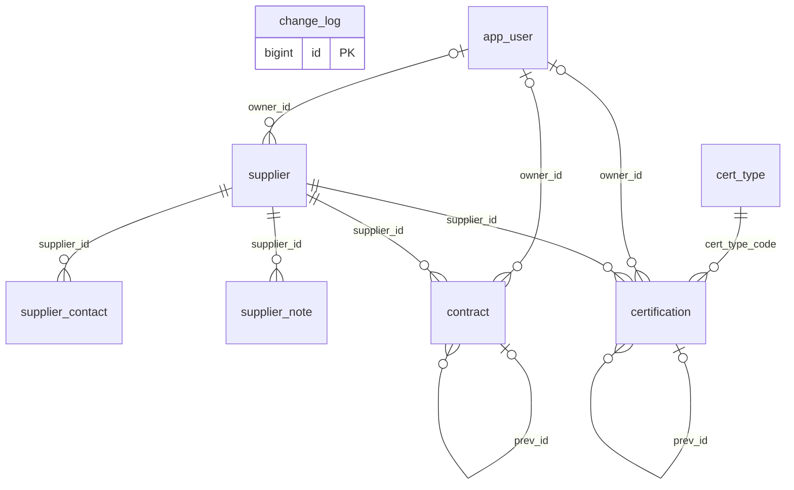
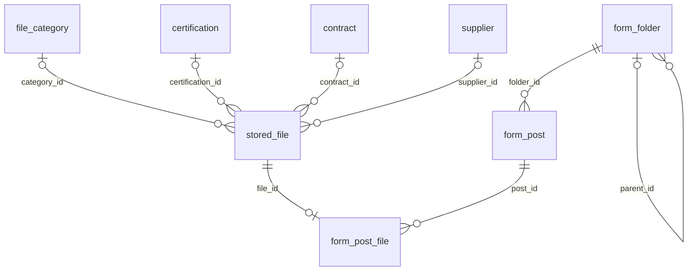
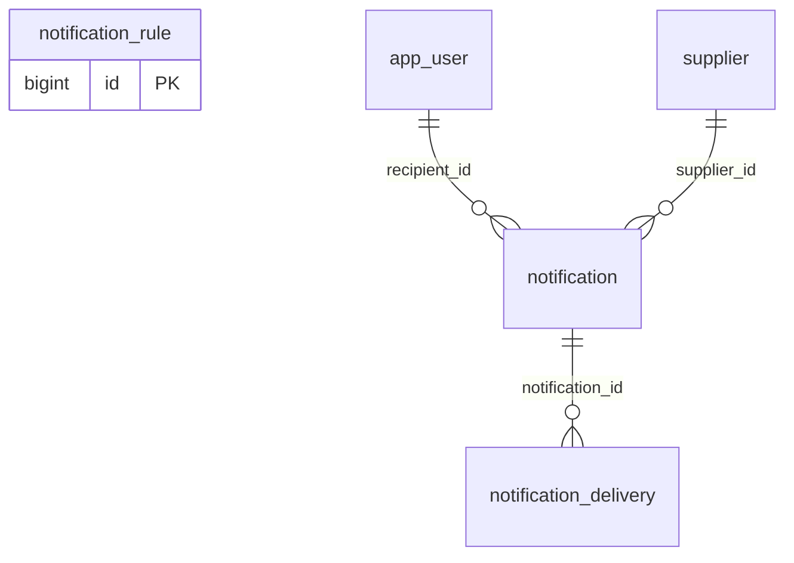

# 협력업체 통합관리 데이터베이스

PostgreSQL의 `public` 스키마에 [Flyway V1~V17](../backend/src/main/resources/db/migration)을 모두 적용한 구조다. 업무 테이블 16개를 다루며, 마이그레이션 실행 이력은 Flyway가 `flyway_schema_history`에서 관리한다.

## 테이블 관계

세 그림은 자식 테이블의 업무 영역으로 나눴다. 선에는 실제 외래 키(FK) 컬럼명을 표시한다. 부모 쪽 원은 부모 지정이 선택이라는 뜻이며, 자식 쪽 갈래는 여러 행을 연결할 수 있다는 뜻이다.

### 회원·협력업체·계약·인증

### 첨부파일·양식 자료실

### 알림·발송

**논리 참조.** `notification.target_type + target_id`로 계약 또는 인증을 찾는다. `rule_days`는 알림 생성 당시의 기준 일수이며 `notification_rule.id`를 가리키는 FK가 아니다. `change_log`의 대상 ID·이름과 작업자 값도 변경 당시의 기록으로 보존하며 FK를 걸지 않는다.

## 테이블 정의

필수는 DB의 `NOT NULL`을 뜻한다. 기본값 ‘—’는 INSERT 시 DB가 넣는 기본값이 없다는 뜻이다. 시퀀스 기본값은 ‘자동 번호’로 표기했다. PK·FK·고유 제약은 해당 컬럼 행에 표시하고 여러 컬럼에 걸친 조건은 표 아래에 적었다.

### `app_user` — 회원 계정, 역할, 승인 상태와 메일 수신 설정

| 컬럼 | PostgreSQL 형식 | 필수 | DB 기본값 | 의미와 키 |
|---|---|---|---|---|
| `id` | `bigint` | 예 | 자동 번호 | 식별자 · PK |
| `username` | `varchar(50)` | 예 | — | 로그인 아이디 · 고유 |
| `password` | `varchar(100)` | 예 | — | 인코딩한 비밀번호 |
| `name` | `varchar(50)` | 예 | — | 표시 이름 |
| `email` | `varchar(100)` | 아니오 | — | 이메일 |
| `role` | `varchar(20)` | 예 | — | 역할 코드 |
| `created_at` | `timestamp` | 예 | — | 생성 시각 |
| `created_by` | `varchar(50)` | 아니오 | — | 생성한 사용자 아이디 |
| `updated_at` | `timestamp` | 예 | — | 마지막 수정 시각 |
| `updated_by` | `varchar(50)` | 아니오 | — | 마지막 수정 사용자 아이디 |
| `status` | `varchar(20)` | 예 | `'ACTIVE'` | 가입·활성 상태 |
| `signup_reason` | `varchar(1000)` | 아니오 | — | 가입 신청 사유 |
| `notify_email` | `boolean` | 예 | `true` | 알림 메일 수신 여부 |

아이디는 고유하며 이메일은 `lower(email)` 값이 고유하다. 상태는 PENDING, ACTIVE, REJECTED, INACTIVE 중 하나다.

### `supplier` — 협력업체 기본정보와 대표 연락처, 담당 사용자

| 컬럼 | PostgreSQL 형식 | 필수 | DB 기본값 | 의미와 키 |
|---|---|---|---|---|
| `id` | `bigint` | 예 | 자동 번호 | 식별자 · PK |
| `code` | `varchar(20)` | 아니오 | — | 업무 코드 · 고유 |
| `name` | `varchar(100)` | 예 | — | 표시 이름 |
| `business_number` | `varchar(20)` | 아니오 | — | 사업자등록번호 |
| `status` | `varchar(20)` | 예 | — | 상태 코드 |
| `contact_name` | `varchar(50)` | 아니오 | — | 대표 연락 담당자 이름 |
| `contact_phone` | `varchar(30)` | 아니오 | — | 대표 연락처 전화번호 |
| `contact_email` | `varchar(100)` | 아니오 | — | 대표 연락처 이메일 |
| `owner_id` | `bigint` | 아니오 | — | 사내 담당자 · FK → `app_user.id` |
| `memo` | `varchar(1000)` | 아니오 | — | 비고 |
| `created_at` | `timestamp` | 예 | — | 생성 시각 |
| `created_by` | `varchar(50)` | 아니오 | — | 생성한 사용자 아이디 |
| `updated_at` | `timestamp` | 예 | — | 마지막 수정 시각 |
| `updated_by` | `varchar(50)` | 아니오 | — | 마지막 수정 사용자 아이디 |
| `deleted_at` | `timestamp` | 아니오 | — | 논리 삭제 시각 |
| `deleted_by` | `varchar(50)` | 아니오 | — | 삭제한 사용자 아이디 |

### `supplier_contact` — 업체별 추가 연락 담당자

| 컬럼 | PostgreSQL 형식 | 필수 | DB 기본값 | 의미와 키 |
|---|---|---|---|---|
| `id` | `bigint` | 예 | 자동 번호 | 식별자 · PK |
| `supplier_id` | `bigint` | 예 | — | 관련 협력업체 · FK → `supplier.id` |
| `name` | `varchar(50)` | 예 | — | 표시 이름 |
| `title` | `varchar(50)` | 아니오 | — | 직책 |
| `phone` | `varchar(30)` | 아니오 | — | 연락처 전화번호 |
| `email` | `varchar(100)` | 아니오 | — | 이메일 |
| `created_at` | `timestamp` | 예 | — | 생성 시각 |
| `created_by` | `varchar(50)` | 아니오 | — | 생성한 사용자 아이디 |
| `updated_at` | `timestamp` | 예 | — | 마지막 수정 시각 |
| `updated_by` | `varchar(50)` | 아니오 | — | 마지막 수정 사용자 아이디 |
| `deleted_at` | `timestamp` | 아니오 | — | 논리 삭제 시각 |
| `deleted_by` | `varchar(50)` | 아니오 | — | 삭제한 사용자 아이디 |

### `supplier_note` — 업체별 소통 날짜·내용과 작성자

| 컬럼 | PostgreSQL 형식 | 필수 | DB 기본값 | 의미와 키 |
|---|---|---|---|---|
| `id` | `bigint` | 예 | 자동 번호 | 식별자 · PK |
| `supplier_id` | `bigint` | 예 | — | 관련 협력업체 · FK → `supplier.id` |
| `contact_date` | `date` | 예 | — | 소통한 날짜 |
| `content` | `text` | 예 | — | 소통 내용 |
| `author_name` | `varchar(50)` | 예 | — | 작성 당시 사용자 이름 |
| `created_at` | `timestamp` | 예 | — | 생성 시각 |
| `created_by` | `varchar(50)` | 아니오 | — | 생성한 사용자 아이디 |
| `updated_at` | `timestamp` | 예 | — | 마지막 수정 시각 |
| `updated_by` | `varchar(50)` | 아니오 | — | 마지막 수정 사용자 아이디 |
| `deleted_at` | `timestamp` | 아니오 | — | 논리 삭제 시각 |
| `deleted_by` | `varchar(50)` | 아니오 | — | 삭제한 사용자 아이디 |

### `contract` — 계약과 갱신 이력

| 컬럼 | PostgreSQL 형식 | 필수 | DB 기본값 | 의미와 키 |
|---|---|---|---|---|
| `id` | `bigint` | 예 | 자동 번호 | 식별자 · PK |
| `supplier_id` | `bigint` | 예 | — | 관련 협력업체 · FK → `supplier.id` |
| `contract_number` | `varchar(50)` | 예 | — | 계약 번호 |
| `title` | `varchar(200)` | 예 | — | 제목 |
| `start_date` | `date` | 예 | — | 계약 시작일 |
| `end_date` | `date` | 아니오 | — | 계약 종료일 |
| `auto_renew` | `boolean` | 예 | — | 자동 갱신 여부 |
| `renewal_status` | `varchar(20)` | 예 | — | 갱신 처리상태 |
| `owner_id` | `bigint` | 아니오 | — | 사내 담당자 · FK → `app_user.id` |
| `prev_id` | `bigint` | 아니오 | — | 갱신 전 계약 또는 인증 · FK → `contract.id` |
| `active` | `boolean` | 예 | — | 사용 또는 현재 유효 여부 |
| `document_url` | `varchar(500)` | 아니오 | — | 참조 문서 링크 |
| `memo` | `varchar(1000)` | 아니오 | — | 비고 |
| `created_at` | `timestamp` | 예 | — | 생성 시각 |
| `created_by` | `varchar(50)` | 아니오 | — | 생성한 사용자 아이디 |
| `updated_at` | `timestamp` | 예 | — | 마지막 수정 시각 |
| `updated_by` | `varchar(50)` | 아니오 | — | 마지막 수정 사용자 아이디 |
| `deleted_at` | `timestamp` | 아니오 | — | 논리 삭제 시각 |
| `deleted_by` | `varchar(50)` | 아니오 | — | 삭제한 사용자 아이디 |

### `cert_type` — 인증 종류와 사용·필수 여부

| 컬럼 | PostgreSQL 형식 | 필수 | DB 기본값 | 의미와 키 |
|---|---|---|---|---|
| `code` | `varchar(30)` | 예 | — | 업무 코드 · PK |
| `name` | `varchar(100)` | 예 | — | 표시 이름 |
| `sort_order` | `integer` | 예 | — | 표시 순서 |
| `active` | `boolean` | 예 | `true` | 사용 또는 현재 유효 여부 |
| `name_key` | `varchar(300)` | 예 | — | 중복 확인용 정규화 이름 · 고유 |
| `required` | `boolean` | 예 | `false` | 필수 지정 여부 |

### `certification` — 인증서와 적용 범위, 만료일 및 갱신 이력

| 컬럼 | PostgreSQL 형식 | 필수 | DB 기본값 | 의미와 키 |
|---|---|---|---|---|
| `id` | `bigint` | 예 | 자동 번호 | 식별자 · PK |
| `supplier_id` | `bigint` | 예 | — | 관련 협력업체 · FK → `supplier.id` |
| `cert_type_code` | `varchar(30)` | 예 | — | 인증 종류 코드 · FK → `cert_type.code` |
| `certificate_number` | `varchar(50)` | 예 | — | 인증서 번호 |
| `issued_date` | `date` | 예 | — | 발급일 |
| `expiry_date` | `date` | 아니오 | — | 만료일 |
| `renewal_status` | `varchar(20)` | 예 | — | 갱신 처리상태 |
| `owner_id` | `bigint` | 아니오 | — | 사내 담당자 · FK → `app_user.id` |
| `prev_id` | `bigint` | 아니오 | — | 갱신 전 계약 또는 인증 · FK → `certification.id` |
| `active` | `boolean` | 예 | — | 사용 또는 현재 유효 여부 |
| `document_url` | `varchar(500)` | 아니오 | — | 참조 문서 링크 |
| `memo` | `varchar(1000)` | 아니오 | — | 비고 |
| `created_at` | `timestamp` | 예 | — | 생성 시각 |
| `created_by` | `varchar(50)` | 아니오 | — | 생성한 사용자 아이디 |
| `updated_at` | `timestamp` | 예 | — | 마지막 수정 시각 |
| `updated_by` | `varchar(50)` | 아니오 | — | 마지막 수정 사용자 아이디 |
| `scope` | `varchar(200)` | 아니오 | — | 인증 적용 대상 |
| `deleted_at` | `timestamp` | 아니오 | — | 논리 삭제 시각 |
| `deleted_by` | `varchar(50)` | 아니오 | — | 삭제한 사용자 아이디 |

### `change_log` — 업체·계약·인증 변경 당시의 대상과 작업자 기록

| 컬럼 | PostgreSQL 형식 | 필수 | DB 기본값 | 의미와 키 |
|---|---|---|---|---|
| `id` | `bigint` | 예 | 자동 번호 | 식별자 · PK |
| `target_type` | `varchar(20)` | 예 | — | 대상 종류 |
| `target_id` | `bigint` | 예 | — | 대상 식별자 |
| `supplier_id` | `bigint` | 예 | — | 관련 협력업체 |
| `supplier_name` | `varchar(100)` | 예 | — | 기록 당시 업체명 |
| `target_name` | `text` | 예 | — | 기록 당시 대상 이름 |
| `action` | `varchar(20)` | 예 | — | 변경 작업 종류 |
| `changes` | `text` | 예 | — | 변경 내역 |
| `actor` | `varchar(50)` | 예 | — | 작업자 아이디 |
| `actor_name` | `varchar(50)` | 예 | — | 작업 당시 사용자 이름 |
| `created_at` | `timestamp` | 예 | — | 생성 시각 |

### `file_category` — 업체 자료의 종류와 필수 서류 여부

| 컬럼 | PostgreSQL 형식 | 필수 | DB 기본값 | 의미와 키 |
|---|---|---|---|---|
| `id` | `bigint` | 예 | 자동 번호 | 식별자 · PK |
| `name` | `varchar(100)` | 예 | — | 표시 이름 |
| `name_key` | `varchar(300)` | 예 | — | 중복 확인용 정규화 이름 · 고유 |
| `active` | `boolean` | 예 | `true` | 사용 또는 현재 유효 여부 |
| `sort_order` | `integer` | 예 | — | 표시 순서 |
| `required` | `boolean` | 예 | `false` | 필수 지정 여부 |

### `stored_file` — 첨부 메타데이터, 저장소 키와 업무 대상 연결

| 컬럼 | PostgreSQL 형식 | 필수 | DB 기본값 | 의미와 키 |
|---|---|---|---|---|
| `id` | `bigint` | 예 | 자동 번호 | 식별자 · PK |
| `original_name` | `varchar(255)` | 예 | — | 업로드 파일명 |
| `content_type` | `varchar(150)` | 예 | — | 파일 MIME 유형 |
| `size_bytes` | `bigint` | 예 | — | 파일 크기(바이트) |
| `storage_key` | `varchar(300)` | 예 | — | 저장소 내 고유 키 · 고유 |
| `deleted_at` | `timestamp` | 아니오 | — | 논리 삭제 시각 |
| `deleted_by` | `varchar(50)` | 아니오 | — | 삭제한 사용자 아이디 |
| `created_at` | `timestamp` | 예 | — | 생성 시각 |
| `created_by` | `varchar(50)` | 아니오 | — | 생성한 사용자 아이디 |
| `updated_at` | `timestamp` | 예 | — | 마지막 수정 시각 |
| `updated_by` | `varchar(50)` | 아니오 | — | 마지막 수정 사용자 아이디 |
| `supplier_id` | `bigint` | 아니오 | — | 관련 협력업체 · FK → `supplier.id` |
| `contract_id` | `bigint` | 아니오 | — | 귀속 계약 · FK → `contract.id` |
| `certification_id` | `bigint` | 아니오 | — | 귀속 인증 · FK → `certification.id` |
| `category_id` | `bigint` | 아니오 | — | 업체 자료 종류 · FK → `file_category.id` |

업체·계약·인증 FK 세 개 중 최대 하나만 지정한다. 셋 다 NULL일 수도 있다. 계약·인증에 귀속된 파일의 업체는 해당 계약·인증에서 찾는다.

### `form_folder` — 양식 자료실의 폴더 계층

| 컬럼 | PostgreSQL 형식 | 필수 | DB 기본값 | 의미와 키 |
|---|---|---|---|---|
| `id` | `bigint` | 예 | 자동 번호 | 식별자 · PK |
| `parent_id` | `bigint` | 아니오 | — | 상위 폴더 · FK → `form_folder.id` |
| `name` | `varchar(100)` | 예 | — | 표시 이름 |
| `deleted_at` | `timestamp` | 아니오 | — | 논리 삭제 시각 |
| `deleted_by` | `varchar(50)` | 아니오 | — | 삭제한 사용자 아이디 |
| `created_at` | `timestamp` | 예 | — | 생성 시각 |
| `created_by` | `varchar(50)` | 아니오 | — | 생성한 사용자 아이디 |
| `updated_at` | `timestamp` | 예 | — | 마지막 수정 시각 |
| `updated_by` | `varchar(50)` | 아니오 | — | 마지막 수정 사용자 아이디 |

최상위 폴더(id=1)만 부모가 없다. 같은 부모 안에서는 삭제되지 않은 이름을 대소문자 구분 없이 한 번만 쓸 수 있다.

### `form_post` — 양식 게시글, 소속 폴더와 수정 버전

| 컬럼 | PostgreSQL 형식 | 필수 | DB 기본값 | 의미와 키 |
|---|---|---|---|---|
| `id` | `bigint` | 예 | 자동 번호 | 식별자 · PK |
| `title` | `varchar(200)` | 예 | — | 제목 |
| `description` | `varchar(5000)` | 아니오 | — | 양식 설명 |
| `category` | `varchar(20)` | 예 | — | 양식 분류 코드 |
| `version` | `bigint` | 예 | `0` | 동시 수정을 감지하는 버전 |
| `deleted_at` | `timestamp` | 아니오 | — | 논리 삭제 시각 |
| `deleted_by` | `varchar(50)` | 아니오 | — | 삭제한 사용자 아이디 |
| `created_at` | `timestamp` | 예 | — | 생성 시각 |
| `created_by` | `varchar(50)` | 아니오 | — | 생성한 사용자 아이디 |
| `updated_at` | `timestamp` | 예 | — | 마지막 수정 시각 |
| `updated_by` | `varchar(50)` | 아니오 | — | 마지막 수정 사용자 아이디 |
| `folder_id` | `bigint` | 예 | `1` | 소속 폴더 · FK → `form_folder.id` |

분류는 CONTRACT, CHECKLIST, OTHER 중 하나다.

### `form_post_file` — 양식과 첨부 파일의 연결

| 컬럼 | PostgreSQL 형식 | 필수 | DB 기본값 | 의미와 키 |
|---|---|---|---|---|
| `post_id` | `bigint` | 예 | — | 양식 게시글 · PK · FK → `form_post.id` |
| `file_id` | `bigint` | 예 | — | 첨부 파일 · 고유 · PK · FK → `stored_file.id` |

(post_id, file_id)가 복합 PK이며 file_id도 고유하므로 같은 파일은 한 게시글에만 첨부할 수 있다.

### `notification_rule` — 대상 종류별 만료 알림 기준

| 컬럼 | PostgreSQL 형식 | 필수 | DB 기본값 | 의미와 키 |
|---|---|---|---|---|
| `id` | `bigint` | 예 | 자동 번호 | 식별자 · PK |
| `target_type` | `varchar(20)` | 예 | — | 대상 종류 · 고유 |
| `days_before` | `varchar(100)` | 예 | — | 만료 며칠 전에 알릴지 정한 값 목록 |
| `channels` | `varchar(100)` | 예 | — | 발송 채널 목록 |
| `enabled` | `boolean` | 예 | — | 기준 사용 여부 |
| `created_at` | `timestamp` | 예 | — | 생성 시각 |
| `created_by` | `varchar(50)` | 아니오 | — | 생성한 사용자 아이디 |
| `updated_at` | `timestamp` | 예 | — | 마지막 수정 시각 |
| `updated_by` | `varchar(50)` | 아니오 | — | 마지막 수정 사용자 아이디 |

### `notification` — 수신자별 만료 알림과 처리 상태

| 컬럼 | PostgreSQL 형식 | 필수 | DB 기본값 | 의미와 키 |
|---|---|---|---|---|
| `id` | `bigint` | 예 | 자동 번호 | 식별자 · PK |
| `target_type` | `varchar(20)` | 예 | — | 대상 종류 |
| `target_id` | `bigint` | 예 | — | 대상 식별자 |
| `rule_days` | `integer` | 예 | — | 이 알림을 생성한 기준 일수 |
| `expiry_date` | `date` | 예 | — | 만료일 |
| `recipient_id` | `bigint` | 예 | — | 알림 수신자 · FK → `app_user.id` |
| `supplier_id` | `bigint` | 예 | — | 관련 협력업체 · FK → `supplier.id` |
| `title` | `varchar(500)` | 예 | — | 제목 |
| `message` | `varchar(1000)` | 예 | — | 알림 본문 |
| `action_status` | `varchar(20)` | 예 | — | 수신자의 처리상태 |
| `action_at` | `timestamp` | 아니오 | — | 처리상태 변경 시각 |
| `created_at` | `timestamp` | 예 | — | 생성 시각 |

(target_type, target_id, rule_days, expiry_date, recipient_id)가 고유하다. 같은 대상·기준·만료일·수신자에 대해 알림을 중복 생성하지 않는다.

### `notification_delivery` — 알림의 채널별 발송 대기·재시도·성공 이력

| 컬럼 | PostgreSQL 형식 | 필수 | DB 기본값 | 의미와 키 |
|---|---|---|---|---|
| `id` | `bigint` | 예 | 자동 번호 | 식별자 · PK |
| `notification_id` | `bigint` | 예 | — | 원본 알림 · FK → `notification.id` |
| `channel` | `varchar(20)` | 예 | — | 발송 채널 |
| `status` | `varchar(20)` | 예 | — | 발송 처리 상태 |
| `retry_count` | `integer` | 예 | — | 재시도 횟수 |
| `next_attempt_at` | `timestamp` | 예 | — | 다음 발송 예정 시각 |
| `last_error` | `varchar(500)` | 아니오 | — | 최근 실패 사유 |
| `sent_at` | `timestamp` | 아니오 | — | 발송 완료 시각 |
| `created_at` | `timestamp` | 예 | — | 생성 시각 |

새 마이그레이션을 추가하는 PR에서는 변경된 컬럼·제약과 관계도를 함께 갱신한다. 초기 설계의 데이터 모델은 5장을 참고한다. [프로토타입 설계](https://github.com/ync-capstone-desgin/capstone-docs/blob/main/docs/team/reference/prototype-design.md)
