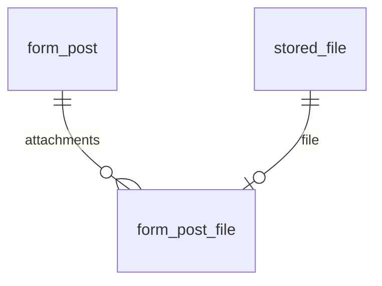

# 사내 양식 자료실 API (#6, FR-022)

업체와 무관한 공용 양식을 게시글과 여러 첨부로 관리한다. 화면은 #7에서 연결한다.

## 권한과 저장 규칙

- 로그인한 사용자는 목록·상세·첨부 다운로드를 이용한다.
- ADMIN·MANAGER는 게시글을 등록·수정·삭제한다. 작성자에 한정하지 않고 공동 관리한다. 기업 질문 Q-10 답변 전 기본 권한이다.
- 게시글과 모든 새 첨부는 한 트랜잭션이다. 한 파일이라도 실패하면 게시글 변경, 첨부 삭제, 새 파일 저장을 모두 취소한다.
- 파일 내용은 기존 로컬 저장소, 메타데이터는 `stored_file`에 보관한다. 기존 파일 ID로 다른 업무의 파일을 연결하는 기능은 없다.
- 게시글 삭제 시 첨부도 논리 삭제한다. 파일 ID를 알아도 다운로드는 404다. DB 감사 기록과 디스크 내용은 남는다.
- 파일 없는 게시글도 가능하다. 기존 파일 정책(기본 파일당 20MB, 요청 전체 21MB)이 적용된다. 다중 첨부의 합계와 multipart 헤더까지 요청 크기에 포함되므로 큰 묶음이 필요하면 `FILE_MAX_REQUEST_SIZE`를 조정한다.

## 엔드포인트

| 요청 | 기능 | 응답 |
|---|---|---|
| GET `/api/forms?keyword=&category=&page=0&size=20` | 제목 검색·분류 필터·최신순 페이지 | 200, `{content, page, size, totalElements}` |
| GET `/api/forms/{id}` | 게시글 상세 및 살아 있는 첨부 | 200 |
| POST `/api/forms` | 게시글·첨부 등록 | 201, 상세 |
| PUT `/api/forms/{id}` | 제목·분류·설명 변경 및 첨부 추가/삭제 | 200, 상세 |
| DELETE `/api/forms/{id}` | 게시글·첨부 논리 삭제 | 204 |
| GET `/api/files/{id}/download` | 기존 API로 원본 다운로드 | 200, 파일 |

분류: `CONTRACT`(계약 양식), `CHECKLIST`(점검표), `OTHER`(기타).
제목: 공백만 입력 불가·최대 200자. 설명: 선택·최대 5000자. 페이지: 0 이상, 크기: 1~100.
존재하지 않거나 삭제된 게시글은 404, 잘못된 입력은 기존 ProblemDetail 형식의 400, 권한 부족은 403, 익명은 401이다.

기존 Tomcat의 큰 요청 처리에는 제한이 있다. 브라우저가 한도 초과 본문을 이미 전송하면 413 응답 대신 연결 오류로 보일 수 있다. #7 화면에서는 선택 파일 합계가 요청 한도를 넘지 않도록 먼저 안내한다.

## 등록·수정 요청

`multipart/form-data`의 `post` 파트는 Content-Type `application/json`으로 전송한다. `files`는 새로 추가할 파일마다 반복하며 생략 가능하다.

```json
{"title":"표준 공급 계약서","description":"작성 방법 안내","category":"CONTRACT","removeFileIds":[]}
```

수정에서도 제목·분류·설명은 전체 값을 전달한다. 기존 첨부는 기본적으로 유지된다. `removeFileIds`에 삭제할 파일 ID를 넣고 새 `files`를 함께 보내면 원자적으로 교체한다. 다른 게시글 파일 ID·중복 ID는 거절한다. 등록 시 `removeFileIds`는 비어 있어야 한다.

```javascript
const data = new FormData();
data.append('post', new Blob([JSON.stringify({
  title: '표준 공급 계약서', category: 'CONTRACT', description: '개정본', removeFileIds: [12]
})], {type: 'application/json'}));
for (const file of selectedFiles) data.append('files', file);
await api.put('/forms/3', data); // Content-Type 경계값은 브라우저가 설정
```

상세 응답 예시:

```json
{
  "id": 3, "title": "표준 공급 계약서", "description": "개정본", "category": "CONTRACT",
  "createdAt": "2026-11-03T14:00:00", "createdBy": "manager1",
  "updatedAt": "2026-11-03T14:10:00", "updatedBy": "manager1",
  "files": [{"id": 13, "originalName": "계약서.pdf", "contentType": "application/pdf", "size": 1024,
             "createdAt": "2026-11-03T14:10:00", "createdBy": "manager1"}]
}
```

목록의 각 행은 위 상세에서 `files`를 제외한 게시글 정보다. 다운로드 파일명·바이트는 기존 파일 API를 따른다.

## DB 및 적용 순서



`V8__forms.sql`이 `form_post`, `form_post_file`을 만든다. 파일 ID UNIQUE로 양식 게시글 간 파일 공유를 막는다. 수정·삭제는 게시글 행 잠금으로 순차 처리하며 첨부 삭제 이력도 같은 트랜잭션에 기록한다.

배포 순서: **#29의 V6 → #30의 V7 → #6의 V8**. 이 브랜치의 독립 테스트는 새 Testcontainers DB를 사용한다. V8을 먼저 적용한 개발 DB에 나중에 V6·V7을 추가하지 말고, 통합 검증에는 별도 DB를 사용한다. 기존 마이그레이션 수정·운영 DB 초기화·out-of-order 허용으로 우회하지 않는다.

검증 명령: `cd backend && ./gradlew test --tests '*FormApiTest'`.

검증 결과: `FormApiTest` 10개 + 실제 서버 `FormHttpTest` 2개를 포함해 백엔드 전체 80개 통과. HTTP 용량 제한 테스트는 1MB로 줄인 요청 한도를 사용한다.

#29·#30 머지 후 develop `961822c` 통합 검증: V1~V8 적용 및 전체 92개 테스트 통과, 프론트엔드 빌드 통과.
