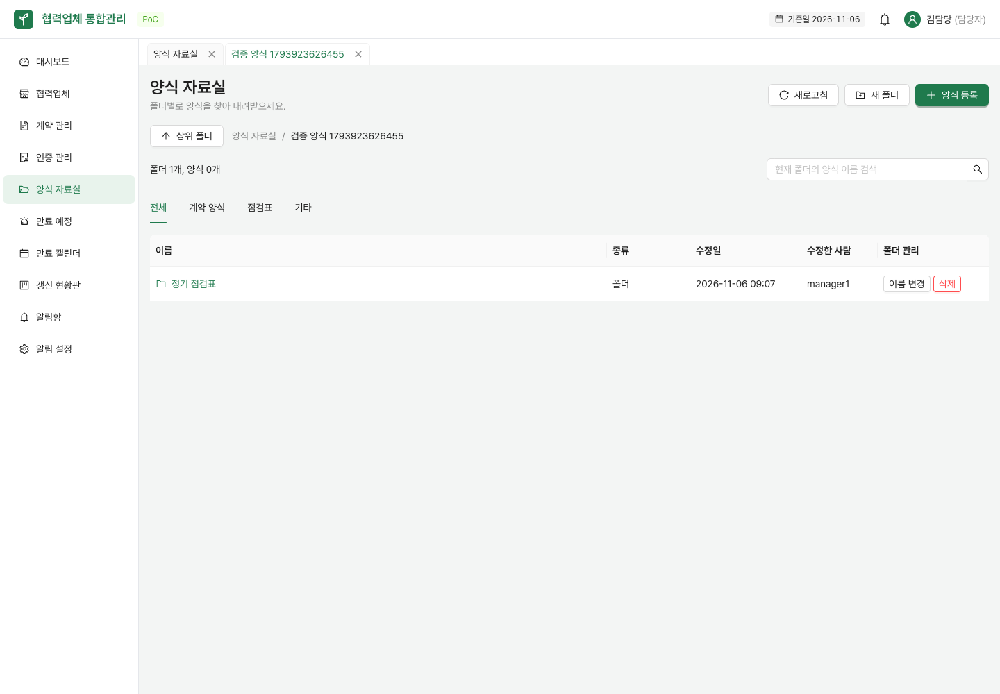
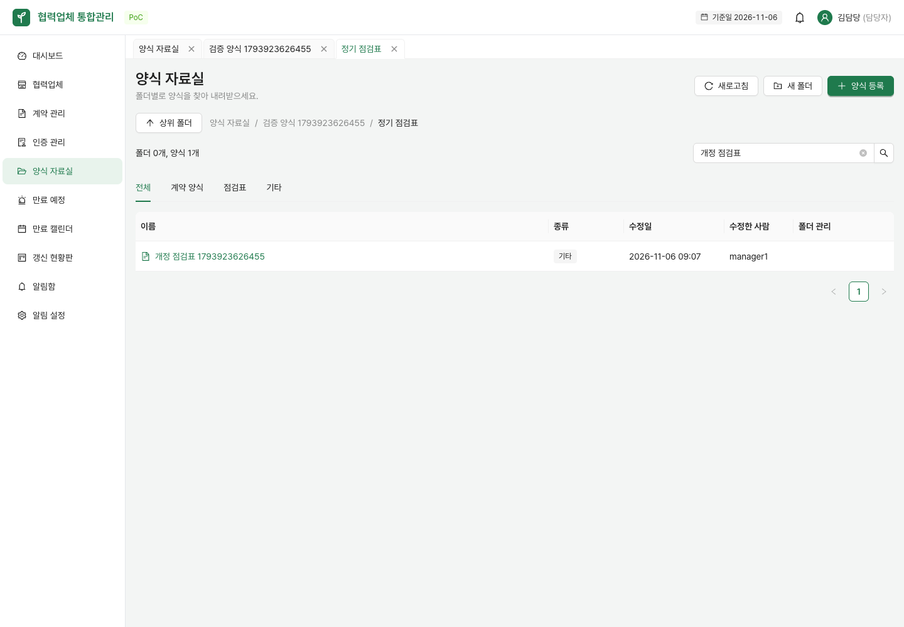
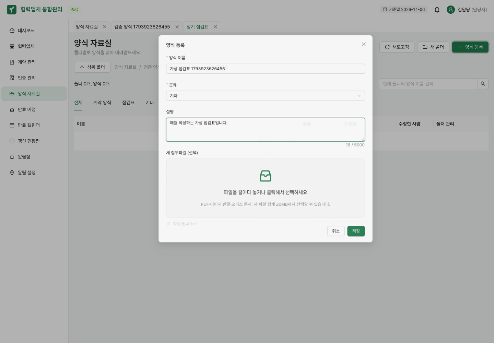
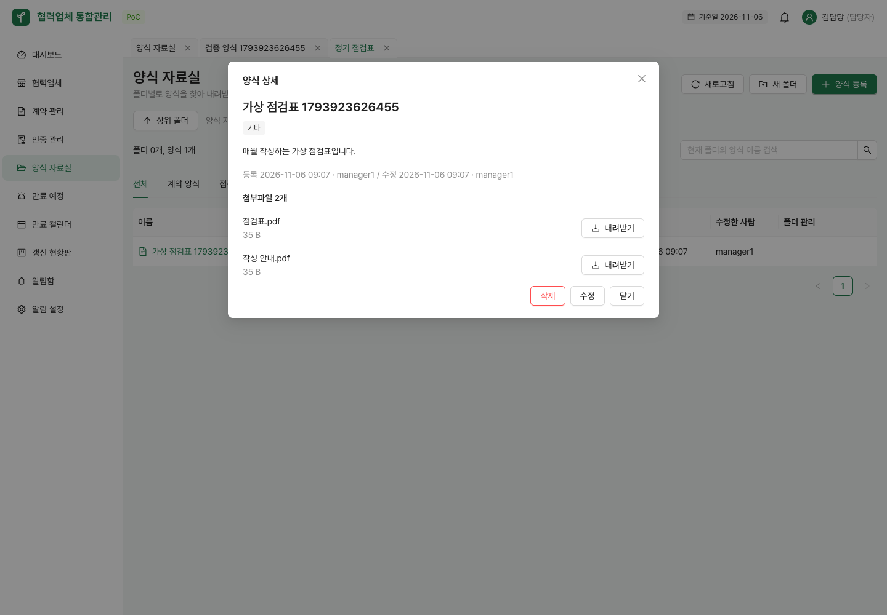
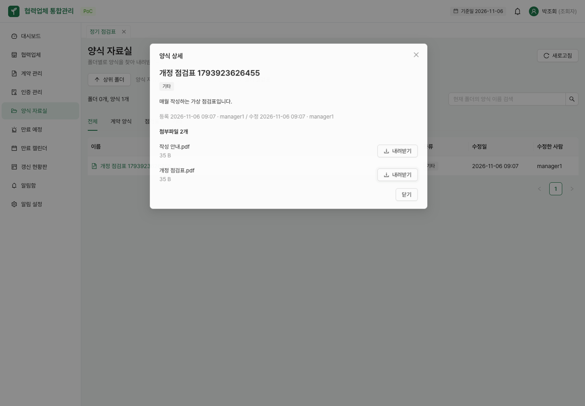

# 폴더형 양식 자료실 (#7)

좌측 **양식 자료실**에서 공용 양식을 폴더별로 정리하고 내려받는다. 로그인한 직원은 모두 탐색·검색·다운로드할 수 있다. 관리자·담당자는 폴더와 양식을 공동 관리하며, 조회자에게는 편집 버튼을 표시하지 않는다.

## 폴더 탐색과 관리

1. **새 폴더**에서 이름을 입력한다. 열린 폴더 안에 생성된다.
2. 폴더 이름을 누르면 들어간다. `HACCP → 점검표 → 월별`처럼 하위 폴더를 만들 수 있다.
3. 상단 경로나 **상위 폴더**를 눌러 돌아간다. 주소를 다시 열어도 같은 폴더로 이동한다.
4. 목록의 **이름 변경**·**삭제**로 폴더를 관리한다. 같은 위치에 중복 이름은 사용할 수 없다.

폴더 안에 하위 폴더나 양식이 있으면 삭제할 수 없다. 자료를 먼저 정리한 뒤 빈 폴더를 삭제한다. 최상위 폴더는 고정이며 폴더 이동·휴지통·외부 공유는 이번 범위에 포함하지 않는다.




## 양식 등록과 다운로드

- 현재 폴더에서 **양식 등록**을 누르고 이름·분류·설명을 적는다. 파일을 여러 개 선택하거나 끌어다 놓고 저장한다.
- 제목·설명을 가진 양식 하나에 여러 첨부를 묶는다. 첨부 없는 안내용 양식도 등록할 수 있다.
- 허용 형식은 PDF, JPG/JPEG/PNG/GIF, HWP/HWPX, DOC/DOCX, XLS/XLSX, PPT/PPTX다. 빈 파일은 거절한다. 화면의 기본 한도는 파일당 20MB, 새로 올리는 파일의 합계 20MB다.
- 양식 이름을 누르면 설명과 등록·수정 정보, 첨부가 열린다. 각 **내려받기**로 원본 이름과 내용을 받는다.
- 검색·분류는 **현재 폴더의 양식**에 적용한다. 하위 폴더 내부까지 검색하지 않는다. 폴더 목록은 유지하고 양식은 최신 등록순 20개씩 표시한다.




## 수정·삭제와 오류 복구

- 상세의 **수정**에서 첨부를 삭제 예정으로 표시하거나 새 첨부를 추가한다. **저장** 전에는 서버 파일을 바꾸지 않는다. 취소하면 기존 첨부가 유지된다.
- 저장 실패 시 입력과 선택 파일을 유지하므로 안내를 확인한 뒤 다시 저장할 수 있다. 한 파일이라도 실패하면 서버는 전체 변경을 취소한다.
- 양식 삭제는 확인 창을 거치며 해당 양식과 첨부를 더 이상 내려받을 수 없게 한다.
- 조회 실패는 **다시 시도** 또는 **새로고침**으로 복구한다. 다른 사용자가 폴더를 삭제했다면 최상위로 돌아간다.



## 개발 검증

Java 21, Node 24, Docker와 로컬 서버가 필요하다. 실제 API 검증은 `.env.example`의 시연 계정을 사용하며 로컬 주소에서만 실행한다. 가상 폴더·PDF를 만들고 종료 시 삭제한다. 기업 실자료를 사용하지 않는다.

```bash
cd backend
./gradlew test --tests '*FormFolderApiTest' --tests '*FormApiTest'
cd ../frontend
npm run build
npm run lint
BASE_URL=http://127.0.0.1:5174 node scripts/check-forms.mjs
BASE_URL=http://127.0.0.1:5174 node scripts/check-form-errors.mjs
```

첫 스크립트는 실제 API의 폴더 탐색·이름 변경·다중 첨부·드롭·원본 다운로드·교체·취소·실패 보존·역할별 권한·삭제를 확인하고 이 문서의 캡처를 저장한다. 두 번째는 가상 응답으로 폴더·목록·상세 실패 복구, 페이지/필터 초기화, 다운로드 404, 업로드 형식·용량 제한을 확인한다. DB를 변경하지 않는다.

DB 변경과 호환성은 [API 명세](forms-api.md)를 참고한다. 서버의 파일 한도 환경변수를 변경할 때는 화면의 기본 안내·검증 한도도 함께 조정해야 한다.
