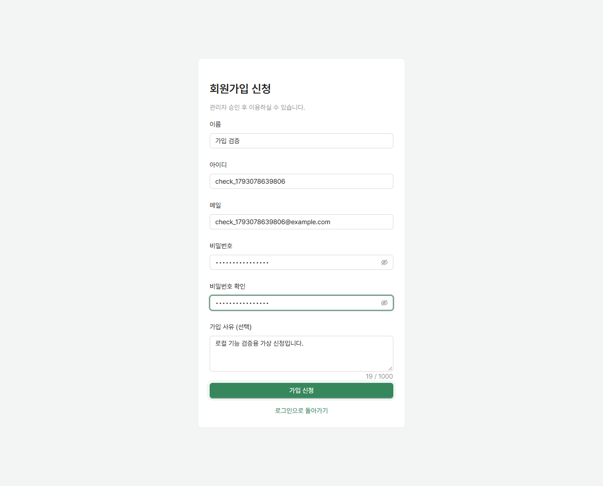
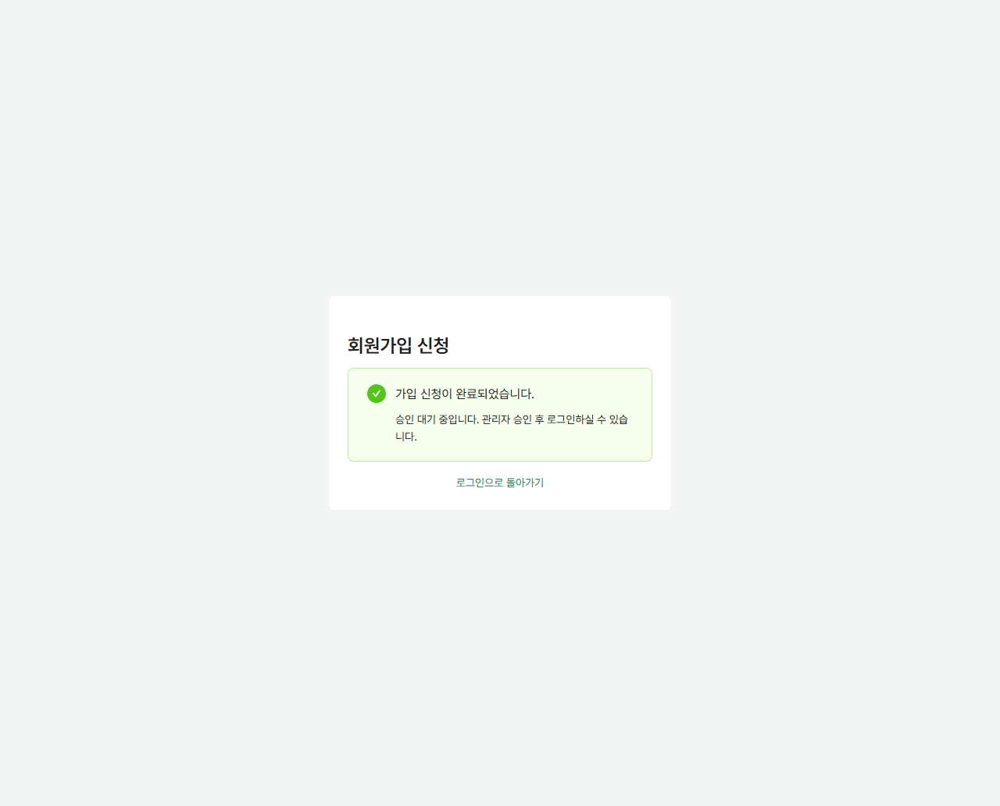
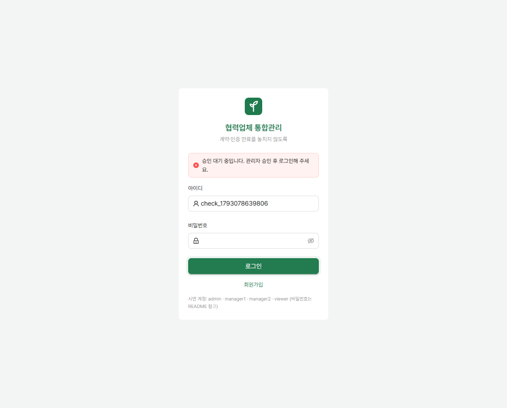
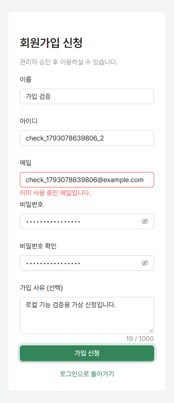

# 회원가입 신청 (#8)

로그인 화면에서 **회원가입**을 선택한다. 신청 성공 시 승인 대기 안내가 나오며 관리자 승인 전에는 로그인할 수 없다. 관리자는 [사용자 관리](user-management.md)에서 승인·거절을 처리한다. 메일 인증은 #11 이후 별도 검토한다.

## API

`POST /api/auth/signup` — 로그인 없이 요청할 수 있다.

```json
{
  "name": "홍길동",
  "username": "hong123",
  "email": "hong@example.com",
  "password": "example123!",
  "passwordConfirm": "example123!",
  "signupReason": "협력업체 관리 업무"
}
```

- 성공: `201 Created`, 응답 본문·로그인 세션 없음.
- 실패: `400`, 기존 ProblemDetail의 `errors: [{field, message}]`로 입력칸 아래에 표시.
- 이름: 필수, 50자 이내. 아이디: 영문·숫자·밑줄 3~50자, 대소문자 구분.
- 메일: 필수, 메일 형식, 100자 이내. 소문자로 저장하고 대소문자 구분 없이 중복 차단.
- 비밀번호: 필수, 8~64자, bcrypt 제한인 UTF-8 72바이트 이내. 확인값 일치 필요. 기존 PasswordEncoder로 해시 저장.
- 가입 사유: 선택, 1000자 이내.
- 공개 요청에서 역할·상태는 지정할 수 없다. 서버가 VIEWER·PENDING으로 저장한다.
- 중복은 제출 시 확인한다. DB 유일성 제약으로 동시 요청도 중복 저장을 막는다.

`POST /api/auth/login` — 올바른 비밀번호가 확인된 뒤 계정 상태를 검사한다. PENDING은 승인 대기, REJECTED는 거절, INACTIVE는 비활성 안내와 함께 `401`을 반환하며 세션을 생성하지 않는다.

## DB 변경

`V5__signup.sql`이 `app_user`에 `status`, `signup_reason`을 추가한다. 기존 계정은 ACTIVE로 이관한다. `lower(email)` 유일 인덱스를 추가하므로 기존 운영 DB에 대소문자만 다른 중복 이메일이 있는지 적용 전에 확인해야 한다. 중복이 있다면 담당자와 확인해 정리하고 마이그레이션을 실행한다.

```sql
select lower(email), count(*) from app_user
where email is not null group by lower(email) having count(*) > 1;
```

승인 대기 계정은 `/api/users` 담당자 선택 목록에서 제외된다. 사용자 상태 변경과 기존 로그인 세션의 권한 갱신은 [사용자 관리](user-management.md)를 참고한다.

## 검증

- `backend`: Java 21과 Docker 실행 후 `./gradlew test` (Windows: `./gradlew.bat test`).
- `SignupApiTest`: 승인 대기 저장, 해시 검증, 세션 미발급, 중복 입력, 비밀번호 제한, ACTIVE 로그인과 REJECTED·INACTIVE 차단.
- `frontend`: `npm run build`, `npm run lint`.
- 직접 확인: 로그인 → 회원가입 링크 → 입력 오류 안내 → 신청 성공 → 신청 계정 로그인 시 승인 대기 안내 → 기존 계정 로그인.
- 브라우저 자동 검증: 로컬 서버 실행 후 `frontend`에서 `node scripts/check-signup.mjs`. 다른 포트는 `BASE_URL` 환경변수로 지정한다. 설치된 Chrome을 사용하며 가상 계정을 생성한다.

## 검증 화면





