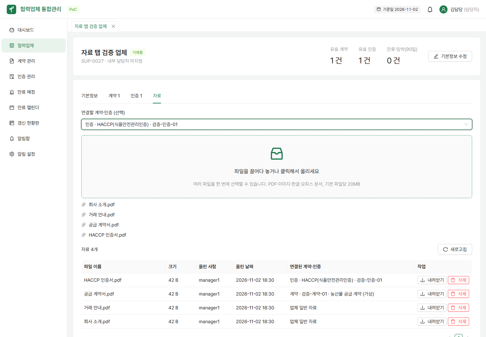
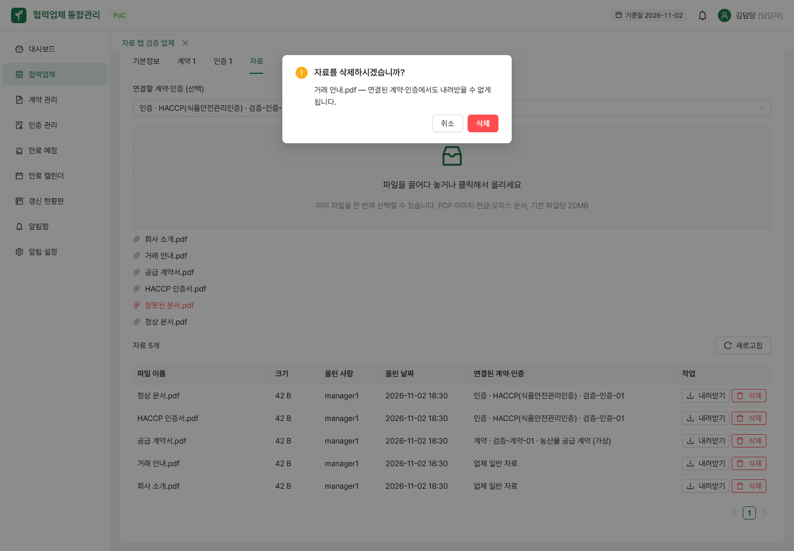
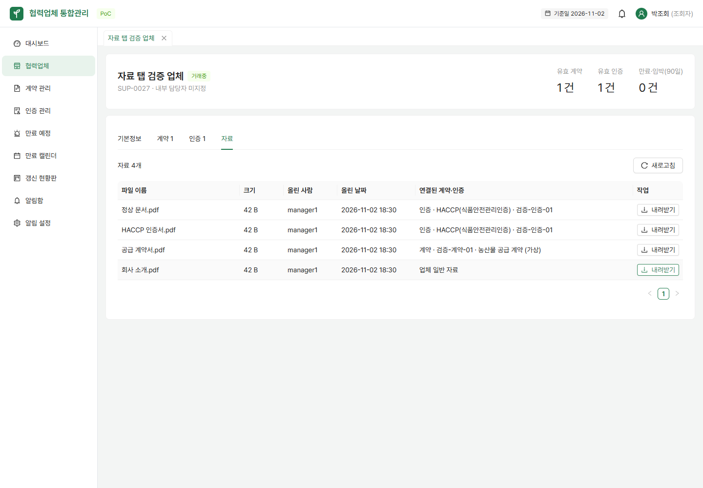
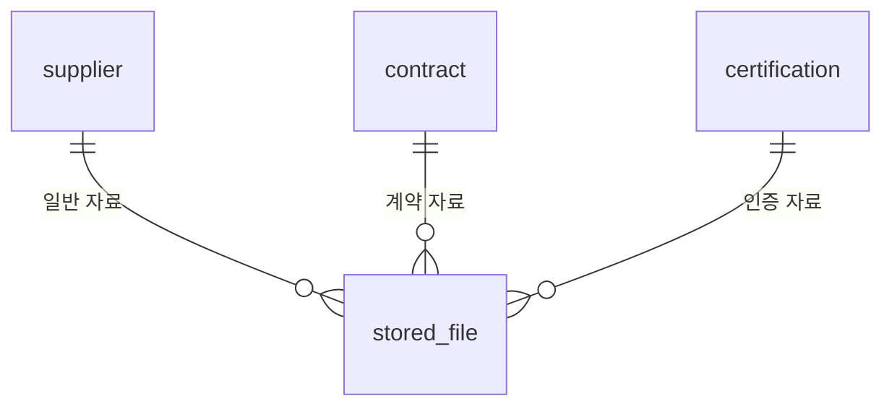

# 업체 자료 탭 (#4, FR-021)

업체 상세에서 **자료** 탭을 연다. 파일 이름·크기·올린 사람·올린 날짜·연결된 계약 또는 인증을 최신순으로 20개씩 보여준다. 갱신되어 이전 이력이 된 계약·인증의 파일도 보관한다.

## 사용 방법

1. 관리자·담당자는 파일을 끌어다 놓거나 업로드 영역을 눌러 여러 파일을 선택한다.
2. 특정 계약·인증 자료라면 올리기 전에 연결할 항목을 선택한다. 선택하지 않으면 업체 일반 자료다.
3. 완료된 파일은 바로 아래 목록에 나타난다. 실패한 파일에는 사유가 표시되고 성공한 파일은 유지된다. 원인을 고친 뒤 실패한 파일만 다시 선택한다.
4. **내려받기**는 원래 파일 이름과 내용으로 저장한다. **삭제**는 확인 창을 거친다. 취소하면 그대로 유지된다.
5. 조회자는 업로드 영역과 삭제 버튼이 보이지 않으며 서버도 업로드·삭제 요청을 403으로 차단한다.

허용 형식과 용량은 기존 파일 API 정책을 따른다. 기본 20MB, PDF·JPG/JPEG·PNG·GIF·HWP/HWPX·DOC/DOCX·XLS/XLSX·PPT/PPTX이다. 서버가 크기·확장자·파일 서명을 검사한다. 삭제 시 파일과 DB 기록은 감사 이력으로 보존하고 목록·다운로드에서 제외한다.





## API

| 요청 | 기능 | 권한 |
|---|---|---|
| `GET /api/suppliers/{supplierId}/files?page=0&size=20` | 업체 일반 자료와 계약·인증 첨부를 함께 조회 | 로그인 사용자 |
| `POST /api/suppliers/{supplierId}/files` | multipart의 `file` 한 개 업로드. `contractId` 또는 `certificationId`를 선택적으로 전달 | ADMIN, MANAGER |
| `GET /api/files/{id}/download` | 기존 API로 원본 다운로드 | 로그인 사용자 |
| `DELETE /api/files/{id}` | 기존 API로 삭제·이력 기록 | ADMIN, MANAGER |
| `GET /api/contracts/{contractId}/files` | 계약 한 건에 연결된 첨부 목록 (최신순, #5) | 로그인 사용자 |
| `GET /api/certifications/{certificationId}/files` | 인증 한 건에 연결된 첨부 목록 (최신순, #5) | 로그인 사용자 |
| `GET /api/contracts/files/counts?ids=1,2,3` | 목록 화면 첨부 아이콘용, 여러 계약의 첨부 개수를 한 번에 (#5) | 로그인 사용자 |
| `GET /api/certifications/files/counts?ids=1,2,3` | 목록 화면 첨부 아이콘용, 여러 인증의 첨부 개수를 한 번에 (#5) | 로그인 사용자 |

목록은 `{content, page, size, totalElements}`이다. `page >= 0`, `1 <= size <= 100`을 허용한다. 한 행과 업로드 성공(201) 응답은 다음 형태다.

```json
{
  "file": {"id": 1, "originalName": "계약서.pdf", "contentType": "application/pdf", "size": 1024,
           "createdAt": "2026-11-02T10:00:00", "createdBy": "manager1"},
  "contractId": 10, "contractName": "CT-01 · 공급 계약",
  "certificationId": null, "certificationName": null
}
```

업체·계약·인증이 없으면 404, 다른 업체의 건이거나 계약·인증 둘 다 지정하면 400이다. 연결 검사를 통과한 뒤 파일을 저장하며, 파일 저장과 연결 정보는 한 트랜잭션이다. 연결 저장 실패 시 기존 `FileService`의 롤백 정리로 디스크 파일도 정리한다. 여러 파일은 파일별 요청이므로 일부 실패 시에도 성공한 파일은 유지된다.

## DB와 후속 작업

`V7__supplier_files.sql`에서 `stored_file`에 nullable FK 세 개(`supplier_id`, `contract_id`, `certification_id`)와 조회 인덱스를 추가한다. 기존 V1~V5는 수정하지 않는다. V6는 진행 중인 마이페이지 PR #29가 사용한다.



파일은 세 대상 중 최대 하나에 연결된다(DB CHECK). 기존 `/api/files`의 연결 없는 업로드도 호환된다. 계약·인증 파일은 해당 건의 현재 업체를 통해 조회하므로 업체 ID를 중복 저장하지 않는다. 갱신 후에도 원래 건에 남는다.

**#5(계약·인증 건에 파일 첨부)에서 추가된 부분**: 계약·인증 등록·수정 창(저장된 건, 즉 수정 모드에서만)에 첨부파일 섹션을 넣고, 업로드는 이 문서의 `POST /api/suppliers/{supplierId}/files`를 `contractId`/`certificationId`와 함께 그대로 재사용한다. 목록 화면(계약 관리·인증 관리)에는 📎 아이콘을 추가해 자료가 1개면 바로 내려받고 여러 개면 작은 목록창(팝오버)을 보여준다. 이를 위해 계약·인증 하나의 첨부 목록 조회, 여러 건의 첨부 개수 일괄 조회 API를 새로 추가했다(아래 표).

배포 DB에는 #29의 V6와 이 PR의 V7을 함께 반영하거나 V6를 먼저 적용한다. V7만 적용한 개발 DB에서 뒤늦게 V6를 가져오면 Flyway 순서 검증에 걸릴 수 있으므로, 해당 개발 DB는 필요한 데이터를 보존한 뒤 별도 검증 DB를 사용한다. 운영 DB의 이력을 지우거나 이미 적용된 마이그레이션을 수정하지 않는다.

## 검증

- `SupplierFileApiTest`: 업체별 격리, 원본 바이트 다운로드, 삭제·감사 이력, 계약·인증 연결과 이전 이력 보존, 페이지 조회, 잘못된 연결 거절, 조회자·익명 권한을 검증한다.
- `AttachmentApiTest`(#5): 계약·인증 건별 첨부 목록 조회, 여러 건의 첨부 개수 일괄 조회(콤마로 이은 `ids` 포함)를 검증한다.
- `backend`: Java 21과 Docker를 준비하고 `./gradlew test`.
- `frontend`: `npm run build`, `npm run lint`.
- 실제 브라우저: 로컬 백엔드와 프론트엔드를 실행하고 `node scripts/check-supplier-files.mjs`. 기본 주소는 `http://127.0.0.1:5174`, `BASE_URL`로 변경한다. Chrome과 개발 시연 계정을 사용하며 가상 업체 2곳·계약·인증·파일을 생성한다. 다른 서버에서는 실행하지 않는다.
