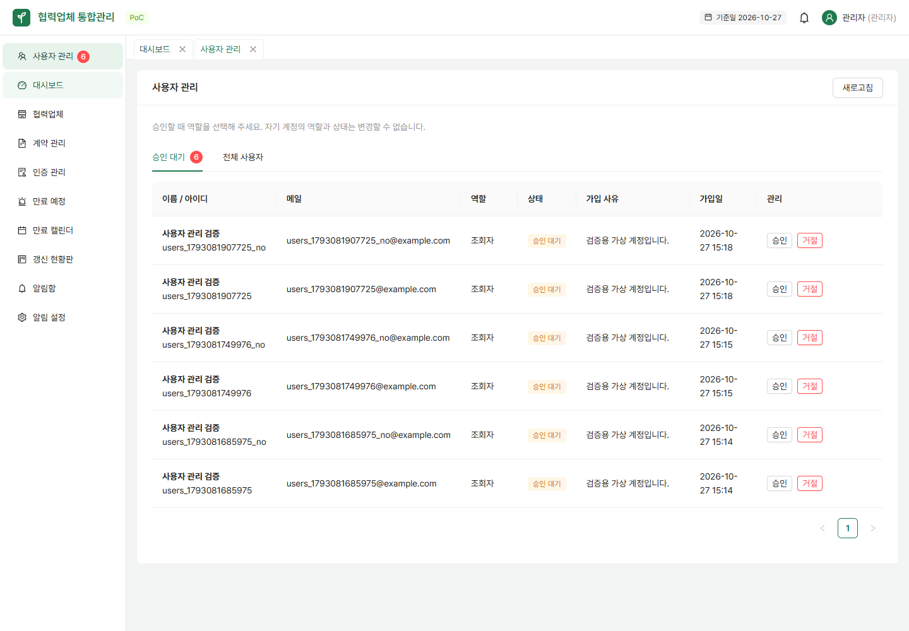
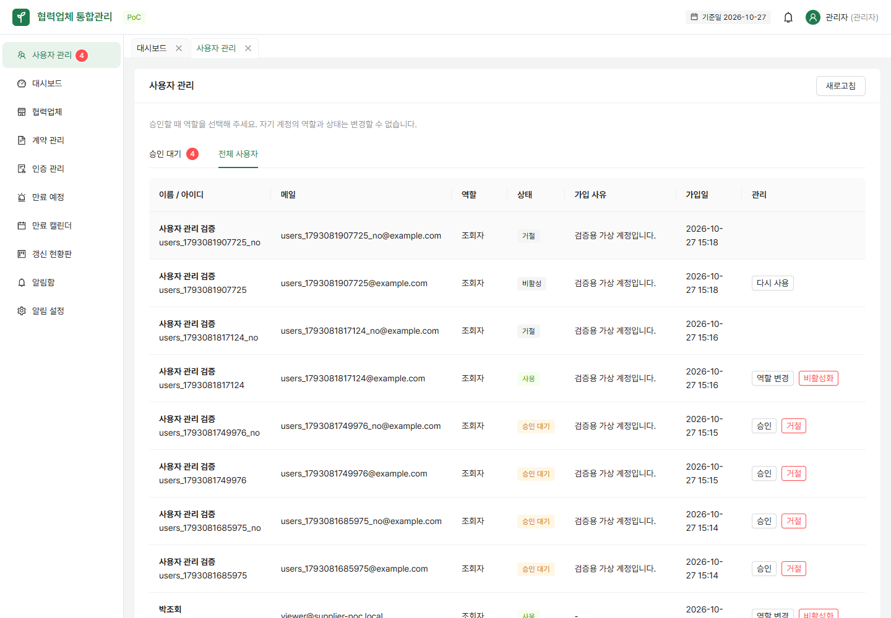
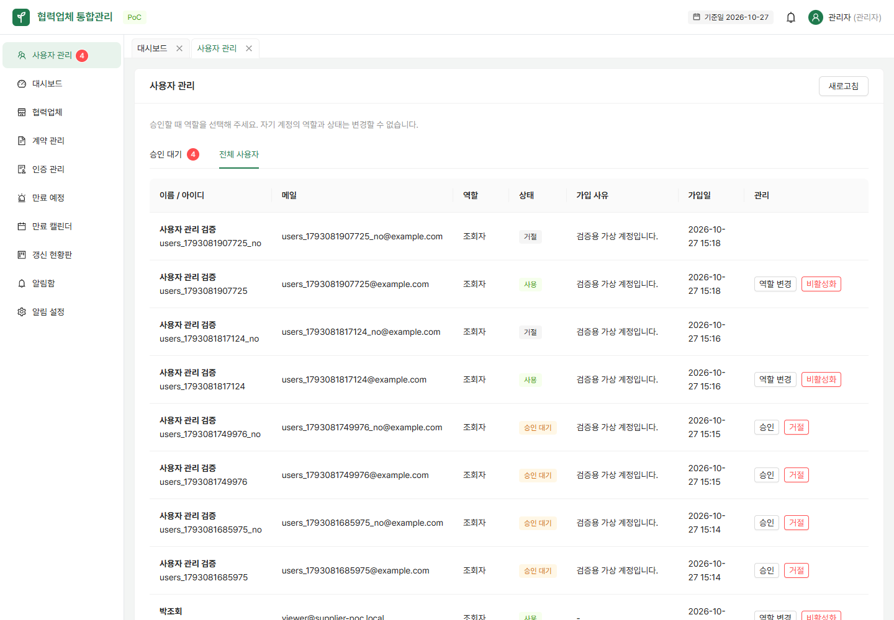

# 관리자 사용자 관리 (#9)

관리자로 로그인하면 좌측에 **사용자 관리** 메뉴와 승인 대기 배지가 보인다. 승인 대기 탭에서 가입 사유를 확인하고 역할(관리자·담당자·조회자)을 선택해 승인하거나 거절한다. 전체 사용자 탭에서는 사용 중인 계정의 역할 변경·비활성화, 비활성 계정의 다시 사용을 처리한다. 거절된 계정은 이 화면에서 재활성화하지 않는다.

## API와 상태 전이

모든 API는 `/api/admin/users` 아래에 있으며 관리자만 접근할 수 있다. 익명은 401, 로그인한 비관리자는 403이다.

- `GET /api/admin/users`: `{ pendingCount, users: [{ id, username, name, email, role, status, signupReason, createdAt }] }`. 비밀번호 해시는 제외한다.
- `POST /api/admin/users/{id}/actions`: `{ "action": "APPROVE", "role": "MANAGER" }`처럼 요청한다. 성공 시 변경된 사용자 정보, 입력 오류 400, 대상 없음 404, 다른 관리자가 먼저 처리했거나 잘못된 상태 전이이면 409를 반환한다.

| action | 허용 상태 | 변경 결과 | role 필요 |
|---|---|---|---|
| APPROVE | PENDING | ACTIVE | 필수 |
| REJECT | PENDING | REJECTED | 없음 |
| CHANGE_ROLE | ACTIVE | 선택한 역할 | 필수 |
| DEACTIVATE | ACTIVE | INACTIVE | 없음 |
| REACTIVATE | INACTIVE | ACTIVE, 기존 역할 유지 | 없음 |

자기 계정의 역할·상태 변경은 화면과 서버 모두 막는다. 사용자 변경 트랜잭션은 사용 가능한 관리자들을 ID 순서로 잠근 후 요청자의 관리자 자격을 다시 확인한다. 대상 사용자도 잠가 동시 승인·거절을 직렬 처리한다. 마지막 활성 관리자를 없애는 변경은 허용하지 않는다. 승인 시 역할 선택이 필요하며 가입자가 보낸 권한은 사용하지 않는다.

## 기존 세션과 데이터

- 권한 필터는 매 HTTP 요청마다 DB에서 최신 사용자 상태·역할을 조회한 뒤 URL 접근 권한을 검사한다. 기존 로그인 세션에서도 다음 요청부터 권한이 바뀐다.
- 비활성화된 사용자는 다음 요청에서 401과 함께 세션이 무효화된다. 무효화된 세션은 다시 사용 처리 후에도 새로 로그인해야 한다. 이미 시작된 요청·SSE 연결을 중간에 취소하는 기능은 이 작업에 포함하지 않는다.
- 화면의 현재 사용자 정보는 메뉴 이동·창 포커스·30초 주기 및 403 응답 때 갱신한다. 메뉴를 숨기는 것과 별개로 서버가 모든 요청을 검사한다. 관리자 권한이 사라지면 사용자 관리 캐시도 제거한다.
- 계정을 삭제하지 않고 상태만 바꾸므로 기존 업체·계약의 담당자 연결은 보존된다.
- #8에서 추가한 status·signup_reason을 그대로 사용하므로 **새 DB 마이그레이션은 없다**.

## 검증

- `UserAdminApiTest`: 승인/거절·상태 전이, 같은 세션의 역할 변경, 비활성화 후 접근 차단 및 업체/계약 FK 보존, 자기 계정 보호, 비관리자 차단, 동시 관리자 상호 강등을 검증한다.
- 백엔드 전체 테스트: Java 21과 Docker를 준비한 뒤 `backend`에서 `./gradlew test` (Windows: `./gradlew.bat test`).
- 프론트엔드: `npm run build`, `npm run lint`.
- 브라우저 검증: 가상 계정 가입 → 관리자 승인(역할 선택) → 해당 계정 로그인 → 역할 변경/비활성화 → 기존 세션 차단 → 다시 사용 후 재로그인.
- 자동 브라우저 검증: 로컬 서버를 실행한 뒤 `frontend`에서 `node scripts/check-user-management.mjs`. 설치된 Chrome을 사용하며 가상 계정을 만든다. 기본 주소는 `http://127.0.0.1:5174`이고 `BASE_URL`로 바꿀 수 있다. 관리자 시연 비밀번호는 `.env.example` 또는 `SEED_PASSWORD`에서 읽는다.

## 화면

